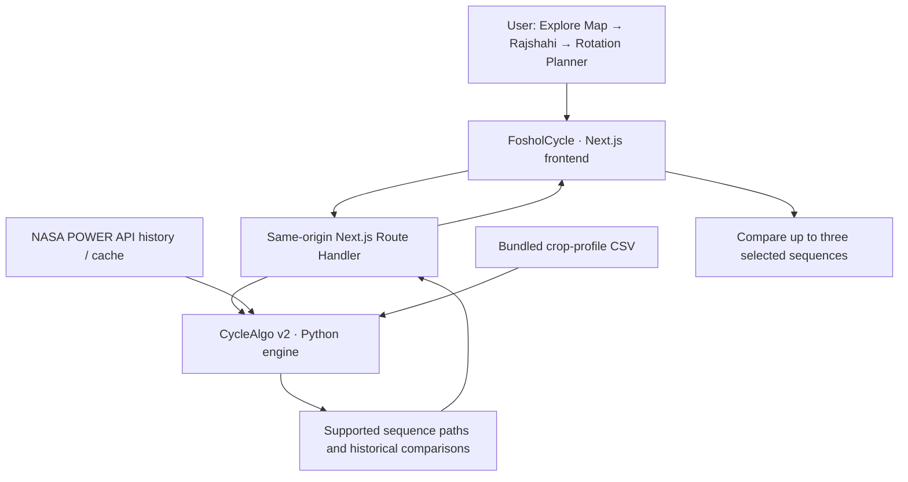

<div align="center">

# 🌾 FosholCycle

### Explore crop rotations with climate-aware comparisons

**A Rajshahi-focused pilot for exploring three-crop sequences using historical weather and crop profiles.**

[Quick Start](#-quick-start) · [Try the Pilot](#-try-the-rajshahi-pilot) · [How It Works](#-how-it-works) · [Run Checks](#-verification--checks) · [Engine Guide](https://github.com/hosain-ahmed/CycleAlgo/blob/main/fosol-cycle-engine/docs/CONNECT.md)

</div>

> [!IMPORTANT]
> **Exploration prototype — not a farm prescription.** FosholCycle helps users compare potential crop sequences; it does **not** recommend a single winning sequence or guarantee crop performance. The Bangladesh map shows **clearly labeled sample climate data**, **not a live NASA map**.

---

## 🌱 Overview

FosholCycle helps users **explore three-crop sequences** for the Rajshahi pilot. Its Rotation Planner supports comparisons across:

| Comparison dimension | What users can explore |
| --- | --- |
| **Timing** | How crop sequences align with the selected planting schedule |
| **Diversity** | Crop diversity across a three-crop sequence |
| **Temperature match** | Temperature-related comparisons from engine results |
| **Dry spells** | Historical dry-spell exposure |
| **Heavy rain** | Historical heavy-rain exposure |

The interface makes these dimensions easier to inspect **without collapsing them into a single overall winner**. Legume presence is **descriptive**, not an additional score.

## 🧭 How It Works



**Where the data comes from**

- **Historical weather:** NASA POWER API history/cache. Production weather does **not** come from local environmental CSV files.
- **Crop profiles:** The bundled crop CSV in the engine.
- **Map display:** Clearly labeled *sample* climate data, separate from the historical comparisons in the Rotation Planner.
- **Default historical scope:** **1991–2025**, at a **representative Rajshahi point/grid** — **not** a district-wide average.

> [!NOTE]
> The engine returns **all supported paths** for a scenario. The **three-sequence limit applies only to the comparison panel**; it does not mean the API returns three fixed examples.

---

## 🚀 Quick Start

### Prerequisites

- **Python 3.11+**
- **Node.js and npm** suitable for the FosholCycle Next.js repository
- **Git**
- **PowerShell** for the commands below
- **Network access on first engine startup**, if the gitignored NASA POWER history cache needs to be populated

Use the current **CycleAlgo v2** engine alongside the **FosholCycle** repository. Keep both projects in separate directories; do not copy the engine into the frontend.

### 1 · Start the Python engine

Open **PowerShell terminal 1**:

```powershell
git clone https://github.com/hosain-ahmed/CycleAlgo.git
Set-Location .\CycleAlgo\fosol-cycle-engine
python -X utf8 -m src.server --host 127.0.0.1 --port 8000
```

> [!CAUTION]
> **Already have a sibling CycleAlgo checkout?** Inspect its local changes before updating it. **Do not** clone over it or reset it. The extracted copy's local `v2` branch contains the updated engine; confirm you are using the intended implementation.

### 2 · Start the Next.js app

Open **PowerShell terminal 2**. Navigate to your **FosholCycle repository root**, then run:

```powershell
curl.exe -fsS http://127.0.0.1:8000/health
npm ci
$env:CYCLE_ALGO_BASE_URL = "http://127.0.0.1:8000"
npm run dev
```

The health check confirms that the Python server is reachable. Set `CYCLE_ALGO_BASE_URL` in the **Next.js terminal** before starting the frontend.

### 3 · Open the pilot

Visit **[http://localhost:3000/explore](http://localhost:3000/explore)** and follow the guided scenario below.

---

## 🧪 Try the Rajshahi Pilot

Open **Explore Map → Rajshahi → Rotation Planner** and use this documented scenario:

| Setting | Value |
| --- | --- |
| **Location** | Rajshahi |
| **Start date** | `2026-11-06` |
| **Water access** | Unknown |
| **First crop** | Boro rice (BRRI dhan28) |
| **Comparison** | Select up to **three** sequences |

1. Enter the scenario settings above in **Rotation Planner**.
2. Review the **supported paths** returned by the engine.
3. Select **up to three sequences** for side-by-side comparison.
4. Open each selected sequence's **historical conditions** to inspect timing, diversity, temperature match, dry spells, and heavy-rain exposure.
5. Change the **date**, **water access**, **first crop**, or **comparison preference** to request updated results from the engine.

> [!TIP]
> Real historical comparisons can take **several seconds**. Keep the loading states visible until the request finishes. If historical weather is unavailable, the interface should communicate that condition rather than pretending to have complete results.

### How to interpret comparisons

The temperature and rainfall views use the **engine's ranked values, directions, common periods, and unavailable states**. The browser does **not** run an independent scoring algorithm.

The UI **does not infer**:

- An overall winning crop sequence
- A crop-damage rating
- Irrigation demand
- Profit or guaranteed yield

Legume presence is presented as **descriptive context only**.

---

## ⚙️ Integration & Data Contracts

| Area | Current behavior |
| --- | --- |
| **Frontend** | Next.js with a same-origin Route Handler |
| **Engine** | CycleAlgo v2 Python implementation |
| **Engine address** | `CYCLE_ALGO_BASE_URL` (default: `http://127.0.0.1:8000`) |
| **Schema version** | JSON `schema_version` is **`"1"`**, despite the v2 product/engine name |
| **Weather source** | NASA POWER API history/cache |
| **Crop profiles** | Bundled crop CSV |
| **Historical default** | 1991–2025, representative Rajshahi point/grid |
| **Planner date limits** | `0002-01-01` to `9990-12-31` |
| **Comparison selection** | Up to three sequences shown together; API returns all supported paths |

### Request flow and networking

- The browser calls a **same-origin Next.js Route Handler**, which calls the Python engine. A broad CORS configuration change is **not required**.
- The handler requests **uncompressed responses** from the Python engine to avoid a reproduced **Node gzip / HTTP/1.0 parser failure**. Next.js or the deployment proxy handles browser-facing compression.
- If the Python server uses another port, change `CYCLE_ALGO_BASE_URL` in the Next.js environment accordingly.
- Missing weather data does **not** silently fall back to a local environmental CSV or fixed demo JSON.

### Historical coverage and interpretation

- The planner accepts dates from **`0002-01-01` to `9990-12-31`**. These are **technical calendar limits**, **not** a promise of NASA weather coverage.
- The response determines the **actual common seasons** and **cache status** shown in the interface.
- **Full-coverage reference-window ranges** are contextual and can differ from **common-period realized-schedule comparisons**. Do not treat them as interchangeable.
- The representative Rajshahi point/grid is **not** a district average, and the map's sample climate layer should not be described as live NASA data.

For more on local engine integration, see the **[CycleAlgo connection guide](https://github.com/hosain-ahmed/CycleAlgo/blob/main/fosol-cycle-engine/docs/CONNECT.md)**.

---

## ✅ Verification & Checks

### Frontend — FosholCycle repository root

Frontend tests use **deterministic fixtures** and do **not** require a running Python engine or network connection.

```powershell
npm test
npm run lint
npm run build
```

### Engine — `CycleAlgo/fosol-cycle-engine`

Run the engine's unit tests and check both bundled contract examples:

```powershell
python -X utf8 -m unittest discover -s tests
python scripts/contract_check.py examples/example_response.json
python scripts/contract_check.py examples/example_error_invalid_input.json --error
```

## 🔧 Troubleshooting Notes

| If you encounter… | Check… |
| --- | --- |
| **Frontend cannot reach engine** | `curl.exe -fsS http://127.0.0.1:8000/health`, then `CYCLE_ALGO_BASE_URL` and the engine port |
| **Historical results take time** | Allow several seconds and keep loading states visible |
| **Historical weather is unavailable** | Initial NASA POWER cache population may need network access; no silent local-CSV or fixed-JSON fallback exists |
| **Unexpected comparison behavior** | Confirm that you are using the current CycleAlgo v2 implementation, and remember that the browser does not rescore engine outputs |
| **Comparisons differ from reference ranges** | Check the actual common periods versus the full-coverage reference window |

---

<div align="center">

**FosholCycle** · Rajshahi pilot

*Explore the possibilities. Compare the evidence. Keep the limitations visible.*

</div>
